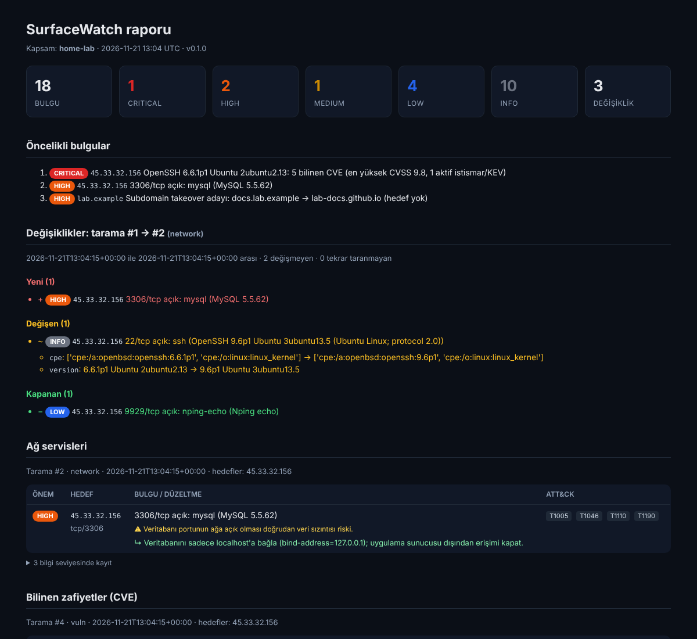

# SurfaceWatch

[](https://github.com/gorkem-pre/surfacewatch/actions/workflows/ci.yml)


SurfaceWatch, kendi sistemlerinin saldırı yüzeyini iki açıdan inceleyen bir araçtır:

- **Red (`scan`):** Saldırgan gözüyle keşif. Açık portlar, servis sürümleri, subdomain'ler, web yapılandırma hataları ve bilinen CVE'ler. Her bulgu MITRE ATT&CK tekniğiyle eşlenir.
- **Blue (`watch`):** Savunmacı gözüyle izleme. Taramalar arasındaki farkı çıkarır (yeni açılan port, değişen sürüm, yaklaşan sertifika bitişi) ve her bulgu için düzeltme önerir.

> ⚠️ Araç **yalnızca `scope.yml` içinde tanımlı hedefleri** tarar. Sadece sahibi olduğun ya da yazılı izin aldığın sistemlerde kullan.


*Örnek HTML rapor (test verisiyle üretildi).*

## Durum

| Modül | Durum |
|---|---|
| 1. Çekirdek: kapsam kontrolü, SQLite kayıt, CLI | ✅ |
| 2. Ağ: Nmap entegrasyonu, servis/sürüm tespiti, MITRE + düzeltme bilgi tabanı | ✅ |
| 3. Pasif OSINT: crt.sh subdomain keşfi, subdomain takeover adayı, SPF/DMARC/CAA, NS/MX | ✅ |
| 4. Web: güvenlik header'ları, TLS, cookie bayrakları, açık hassas dosyalar | ✅ |
| 5. Zafiyet: servis sürümü → CVE (NVD API 2.0), KEV işaretleme, yerel sürüm aralığı eşleme | ✅ |
| 6. Diff motoru (blue), `watch` (cron/CI), HTML rapor | ✅ |

## Kurulum

```bash
git clone https://github.com/gorkem-pre/surfacewatch.git
cd surfacewatch
python -m venv .venv && source .venv/bin/activate
pip install -e ".[dev]"
```

## Kullanım

Aşağıdaki örnekler [scanme.nmap.org](http://scanme.nmap.org/) üzerinde yapılmıştır. Nmap ekibi bu sunucuyu hafif taramalar için herkese açmıştır.

**1. Kapsamı tanımla**

```bash
surfacewatch init          # scope.yml şablonu oluşturur
```

```yaml
# scope.yml
name: home-lab
targets:
  hosts:
    - 45.33.32.156                    # scanme.nmap.org IPv4
    - 2600:3c01::f03c:91ff:fe18:bb2f  # scanme.nmap.org IPv6
  domains:
    - name: scanme.nmap.org
      include_subdomains: false
options:
  max_rate: 100
```

**2. Kapsamı doğrula**

```bash
surfacewatch scope check scanme.nmap.org 45.33.32.156 8.8.8.8
```

```
İZİN  scanme.nmap.org      domain ve çözümlenen IP'ler kapsamda  [2600:3c01::f03c:91ff:fe18:bb2f, 45.33.32.156]
İZİN  45.33.32.156         IP kapsamda
RED   8.8.8.8              IP hiçbir kapsam ağında değil
```

**3. Tara**

```bash
surfacewatch scan scanme.nmap.org -v
```

```
[i] IPv6 atlandı 2600:3c01::f03c:91ff:fe18:bb2f (dahil etmek için --ipv6)
[*] Taranıyor: scanme.nmap.org (45.33.32.156)  profil=default  max_rate=100
    $ nmap -sT -sV --version-light -T3 --max-rate 100 -n -oX - -Pn --top-ports 1000 45.33.32.156
    45.33.32.156: up, 3 açık, 997 filtreli, 0 kapalı, RTT 194.9 ms

ÖNEM      HEDEF              PORT       SERVİS         SÜRÜM
LOW       45.33.32.156       tcp/9929   nping-echo     Nping echo
          MITRE  : T1046
          düzelt : Bu servis gerçekten gerekli mi? Gerekli değilse kapat; ...
INFO      45.33.32.156       tcp/22     ssh            OpenSSH 6.6.1p1 Ubuntu 2ubuntu2.13
          risk   : Uzaktan yönetim kapısı; brute force'un ilk hedefi.
          MITRE  : T1021.004, T1046, T1110
          düzelt : Parola ile girişi kapat (PasswordAuthentication no), sadece anahtar kullan; ...
INFO      45.33.32.156       tcp/80     http           Apache httpd 2.4.7
          MITRE  : T1046, T1190, T1595.002
          düzelt : HTTPS'e yönlendir (301 + HSTS); sürüm bilgisini gizle ...

3 bulgu  low: 1  info: 2
```

**4. Geçmiş**

```bash
surfacewatch show          # son taramanın bulguları
surfacewatch show 1 -v     # belirli bir tarama
surfacewatch scans         # tarama geçmişi
```

**5. Pasif OSINT**

Hedefe hiçbir paket gönderilmez. Certificate Transparency kayıtları (crt.sh) ve DNS üzerinden bilgi toplanır.

```bash
surfacewatch osint ornek.com          # e-posta güvenliği, DNS ve subdomain'ler
surfacewatch osint ornek.com -v       # çözülmeyen eski kayıtlar + MITRE + düzeltme
surfacewatch osint ornek.com --no-ct  # sadece DNS kontrolleri
```

```
E-posta ve DNS
LOW       dns/caa      CAA kaydı yok: her sertifika otoritesi sertifika verebilir
LOW       email/dmarc  DMARC: p=none, sadece izleme yapıyor, engellemiyor
LOW       email/spf    SPF: ~all (softfail)
INFO      dns/ns       NS: ns1.registrar.example, ns2.registrar.example

Subdomain'ler (7 bulundu, 4 çözülüyor)
ÖNEM      İSİM                     IP                AKTİF TARAMA
HIGH      docs.ornek.com           dangling          -
          Subdomain takeover adayı: docs.ornek.com -> ornek-docs.github.io (hedef yok)
LOW       dev.ornek.com            192.168.56.20     izin
          Hassas görünen subdomain internete açık: dev.ornek.com
INFO      cdn.ornek.com            104.16.1.1        RED
```

`AKTİF TARAMA` sütunu her subdomain için kapsam kararını gösterir: bulunan her şey taranabilir değildir.

| Kontrol | Ne arar | Neden önemli |
|---|---|---|
| SPF | Kayıt yok, `+all`, `?all`, birden fazla kayıt | Domain adına sahte e-posta gönderilebilir (T1566, T1656) |
| DMARC | Kayıt yok, `p=none` | Sahte e-postalar alıcıda reddedilmez |
| CAA | Kayıt yok | Her CA domain için sertifika verebilir |
| Dangling CNAME | CNAME hedefi artık yok | GitHub Pages/S3/Azure gibi servislerde subdomain takeover (T1584.001) |
| Hassas isimler | `dev`, `staging`, `jenkins`, `admin`... | İç ortamların internete açık kalması |
| NS / MX envanteri | Kayıtların listesi | Diff motoru NS değişimini yakalar (domain ele geçirme işareti) |

**6. Web kontrolleri**

```bash
surfacewatch web http://scanme.nmap.org       # tek hedef
surfacewatch web ornek.com                    # şema yoksa http:80 ve https:443 denenir
surfacewatch web --from-scan                  # son ağ taramasında bulunan tüm http/https servisleri
surfacewatch web 192.168.56.10:8080 -v --no-files
```

```
http://127.0.0.1:8099  (9 kontrol, 3 gizli bilgi)
HIGH      Git deposu açıkta (.git): http://127.0.0.1:8099/.git/HEAD
MEDIUM    HTTP şifresiz servis ediliyor, HTTPS'e yönlendirme yok
LOW       Sürüm bilgisi ifşa ediliyor: server: SimpleHTTP/0.6 Python/3.13
LOW       Clickjacking koruması yok (X-Frame-Options / frame-ancestors)
```

| Kontrol | Ne arar |
|---|---|
| Yönlendirme | HTTP'nin 301 ile HTTPS'e gidip gitmediği |
| Header'lar | HSTS (ve max-age), CSP, X-Content-Type-Options, Referrer-Policy, Permissions-Policy, clickjacking koruması |
| Bilgi ifşası | `Server` / `X-Powered-By` içinde sürüm numarası |
| Cookie | Oturum cookie'lerinde Secure, HttpOnly, SameSite eksikliği |
| TLS | Sertifika doğrulama hatası, kalan gün, TLS 1.0/1.1 kabulü |
| Hassas dosyalar | `.git/HEAD`, `.env`, `.svn`, `.DS_Store`, `server-status`, `phpinfo.php` |
| robots.txt | Gizlenmeye çalışılan yollar (bilgi) |

Hedef başına yaklaşık 10 istek gönderilir ve istekler arasında bekleme vardır. Hassas dosyalarda sadece HTTP 200'e bakılmaz, içerik de doğrulanır (ör. `.git/HEAD` gerçekten `ref: refs/...` ile mi başlıyor). Böylece her yola 200 dönen sunucularda yanlış alarm verilmez.

**7. Bilinen zafiyetler (CVE)**

```bash
export NVD_API_KEY=...          # opsiyonel, ücretsiz: https://nvd.nist.gov/developers/request-an-api-key
surfacewatch vuln               # son ağ taramasındaki servis sürümleri -> NVD
surfacewatch vuln -v            # tüm CVE'ler ve açıklamaları
surfacewatch vuln --refresh     # NVD önbelleğini yenile (varsayılan 24 saat)
```

Nasıl çalışır:
1. Nmap'in verdiği CPE'den üretici, ürün ve sürüm çıkarılır (`cpe:/a:openbsd:openssh:6.6.1p1`).
2. NVD'den ürünün **tüm** CVE'leri çekilir ve `~/.cache/surfacewatch/nvd/` altında önbelleklenir. Anahtarsız kullanımda NVD sınırına (30 sn'de 5 istek) uyulur.
3. Her CVE'nin CPE eşleme kriterleri (`versionStartIncluding`, `versionEndExcluding` vb.) **yerelde** değerlendirilir. Hangi kuralın neden eşleştiği şeffaf ve test edilebilir.
4. CISA KEV listesindeki (aktif istismar edilen) CVE'ler öne alınır ve bulgunun önemi bir kademe yükseltilir.

> **Sınırlama:** Sürüm tabanlı eşleme dağıtım backport'larını göremez. `OpenSSH 6.6.1p1 Ubuntu 2ubuntu2.13` eski sürüm numarası taşısa da birçok yamayı içerebilir. Araç bu durumu algılayıp uyarı ekler; sonuçlar dağıtımın güvenlik bültenleriyle doğrulanmalıdır.

**8. Değişiklik izleme (blue modu)**

```bash
surfacewatch diff                      # son tarama vs aynı kapsam/modüldeki bir önceki
surfacewatch diff 7 3                  # iki taramayı elle seç
surfacewatch watch 192.168.56.0/24 -q  # tara + karşılaştır; sadece değişiklikleri yazdır
```

```
+ YENİ     HIGH      45.33.32.156       3306/tcp açık: mysql (MySQL 5.5.62)
~ DEĞİŞTİ  INFO      45.33.32.156       22/tcp açık: ssh (OpenSSH 9.6p1 ...)  (değişti)
                              version: 6.6.1p1 Ubuntu 2ubuntu2.13 -> 9.6p1 Ubuntu 3ubuntu13.5
- KAPANDI  LOW       45.33.32.156       9929/tcp açık: nping-echo (Nping echo)

1 yeni, 1 değişen, 1 kapanan, 2 aynı
```

- Bulgular `(hedef, modül, anahtar)` kimliği ve içerik hash'iyle eşleştirilir.
- Bu taramada hiç taranmayan hedeflerin bulguları "kapandı" sayılmaz.
- `--fail-on medium` (watch için varsayılan): bu önem ve üstünde yeni ya da kötüleşen bulgu varsa çıkış kodu `1` döner. Cron veya CI ile alarm üretmek için:

```cron
# Her gece 03:17'de lab ağını tara; değişiklik varsa log'a yaz
17 3 * * * cd ~/surfacewatch && .venv/bin/surfacewatch watch 192.168.56.0/24 -q >> watch.log 2>&1 || echo "$(date) DEĞİŞİKLİK" >> alerts.log
```

**9. HTML rapor**

```bash
surfacewatch report -o rapor.html            # her modülün son taraması + değişiklikler
surfacewatch report --scans 2 4 5 -o r.html  # belirli taramalar
```

Tek dosya, JavaScript yok, CDN yok: e-postayla gönderilebilir, çevrimdışı açılır. Öncelikli bulgular, değişiklikler, modül bazlı tablolar (düzeltme önerileriyle), CVE listeleri (NVD linkli), MITRE ATT&CK eşlemesi ve yöntem/sınırlamalar bölümü içerir. Bulgu içerikleri uzak sistemlerden geldiği için tüm değerler escape edilir ve CSP ile script çalıştırma kapatılır.

**Diğer seçenekler**

```bash
surfacewatch scan 192.168.56.0/28 --profile quick     # kendi lab ağın (top 100 port)
surfacewatch scan 192.168.56.10 -p 22,80,443          # belirli portlar
surfacewatch scan scanme.nmap.org --ipv6              # IPv6 adreslerini de tara
```

> `scanme.nmap.org` üzerinde `--profile full` kullanma; tüm 65.535 portu tarar ve paylaşılan bir sunucuyu yorar.

## Kapsam güvenliği

Kapsam kontrolü aracın en kritik parçasıdır ve tüm aktif modüller ondan geçer:

1. **`exclude` her şeyi ezer.** Hariç tutulan bir IP'yi kapsayan ağ taraması da reddedilir.
2. **Domain sahipliği, IP sahipliği demek değildir.** `cdn.ornek.com` senin domain'in olabilir ama Cloudflare'e çözülüyorsa o sunucuyu taramak Cloudflare'i taramaktır. Aktif taramada çözümlenen tüm IP'ler de kapsamda olmalı; tek bir IP bile dışarıdaysa hedef reddedilir:
   ```
   RED   cdn.ornek.com   domain kapsamda ama çözümlenen IP kapsam dışı: 104.16.1.1 (üçüncü taraf sunucu olabilir)
   ```
3. **Sonek hilelerine karşı:** `evil-lab.local` ve `lab.local.evil.com`, `lab.local` kapsamına girmez.
4. **Aşırı geniş kapsam reddedilir:** /16'dan büyük ağlar kabul edilmez.
5. **Pasif / aktif ayrımı:** CT log ve DNS sorgusu gibi hedefe paket göndermeyen işlemler sadece domain kuralına bakar.
6. **IP sabitleme (TOCTOU koruması):** Domain taranırken Nmap'e hostname değil, kapsam kontrolünde çözümlenen IP verilir. Kontrol ile tarama arasında DNS kaydı değişse bile (DNS rebinding) kontrol edilen adres taranan adrestir.
7. **Web isteklerinde de IP sabitleme:** HTTP bağlantısı doğrulanmış IP'ye açılır; `Host` header'ı ve TLS SNI orijinal hostname ile gönderilir.
8. **Enjeksiyon yok:** Nmap `shell=True` olmadan liste argümanlarla çağrılır; hedef `ipaddress` ile, port listesi regex'siz sayısal kontrolle doğrulanır.
9. **Yanlış negatife karşı uyarı:** Her host için açık/filtreli/kapalı port sayısı ve RTT gösterilir. Hiç açık port yoksa ya da RTT uzak bir host için gerçekçi değilse (ör. VirtualBox NAT'ın kendi verdiği 0.2 ms'lik cevap), araç sonucun yanıltıcı olabileceğini söyler. Tek IP hedeflerde varsayılan olarak `-Pn` kullanılır.
10. **Hız sınırı:** `options.max_rate` (varsayılan 100 paket/sn) her taramaya uygulanır. NSE script'leri çalıştırılmaz.

## Mimari

```
surfacewatch/
├── core/
│   ├── scope.py     kapsam yükleme, doğrulama ve karar (Decision + gerekçe)
│   ├── models.py    Finding: tüm modüllerin ortak bulgu formatı (MITRE + remediation)
│   ├── diff.py      iki tarama arasında yeni / değişen / kapanan bulgular
│   └── storage.py   SQLite: scans / findings, diff için son iki tarama
├── modules/
│   ├── network.py   nmap komutu, XML parse, Finding üretimi
│   ├── knowledge.py servis → önem, MITRE, düzeltme bilgi tabanı
│   ├── osint.py     crt.sh, subdomain analizi, SPF/DMARC/CAA
│   ├── web.py       header, TLS, cookie, hassas dosya kontrolleri
│   ├── vuln.py      CPE -> NVD, sürüm aralığı eşleme, KEV, önbellek
│   └── dnsclient.py DNS arayüzü (dnspython / testler için FakeDns)
├── report.py        tek dosyalık HTML rapor
└── cli.py
```

Her `Finding` için `(target, module, key)` kimliği ve `data` hash'i (fingerprint) tutulur. Diff motoru bu ikisiyle bulguları "yeni", "kapandı" ya da "değişti" olarak sınıflandırır.

## Test

```bash
pytest -q
ruff check .
```

## Geliştirme notu

Bu proje AI asistanı (Claude) desteğiyle geliştirildi; tasarım kararları, test ve doğrulama tarafımdan yapıldı.

## Lisans

MIT
